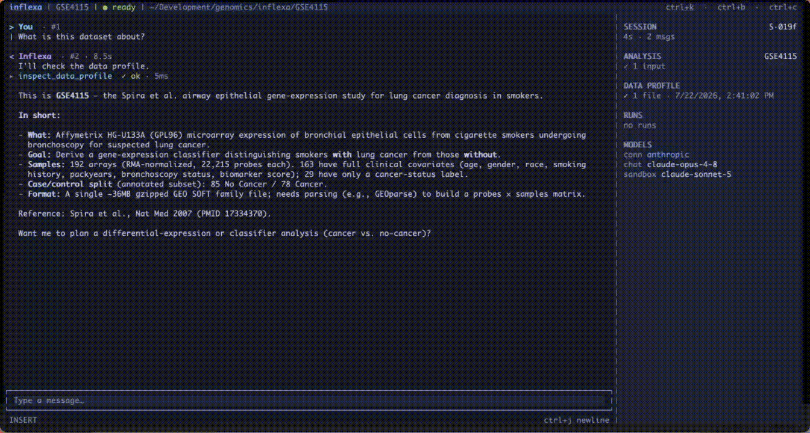
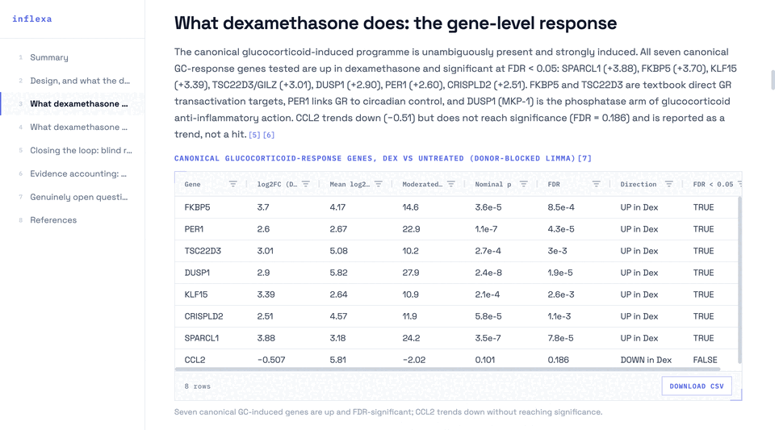
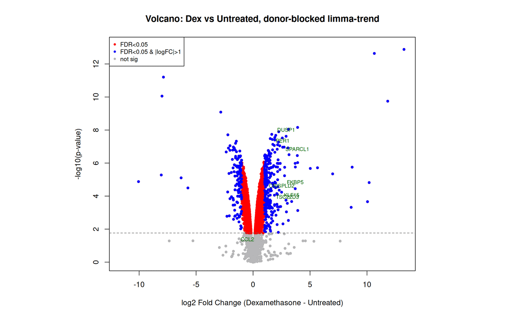
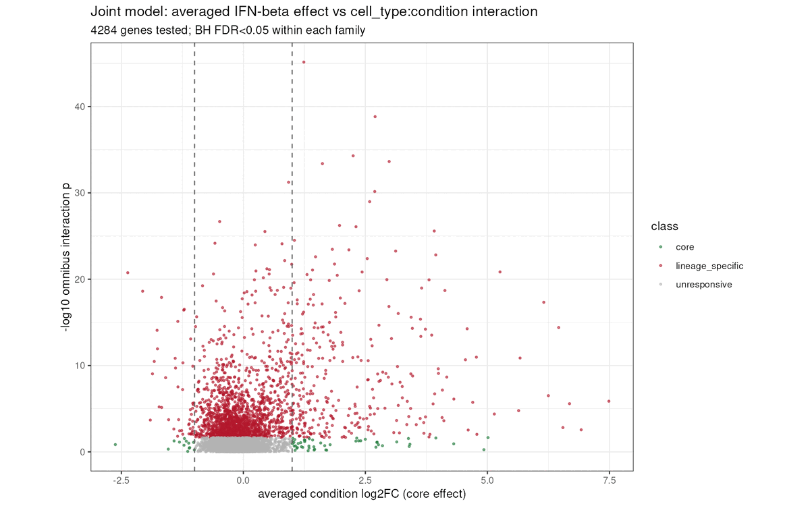
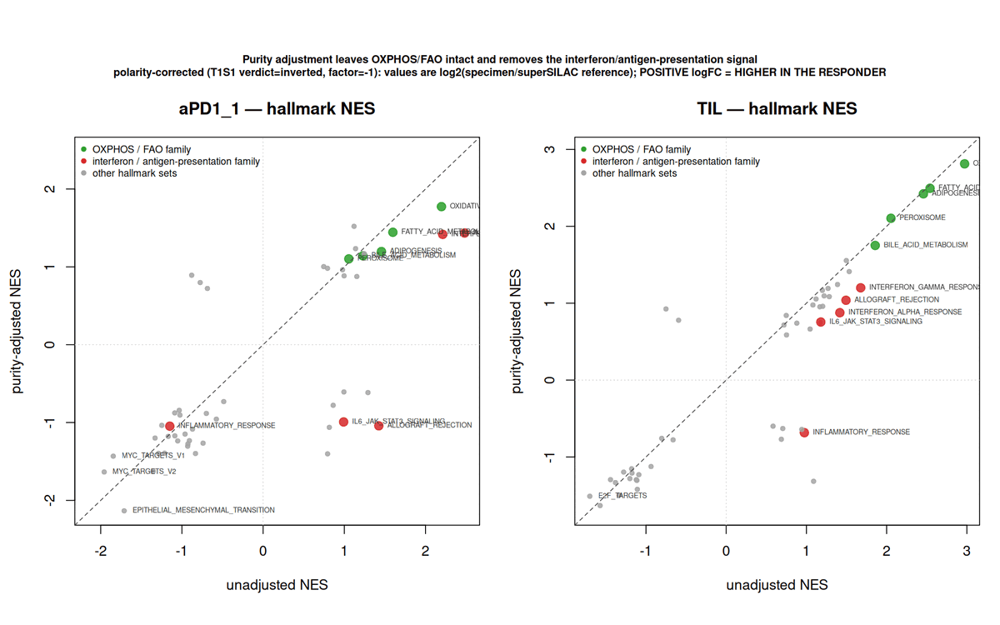
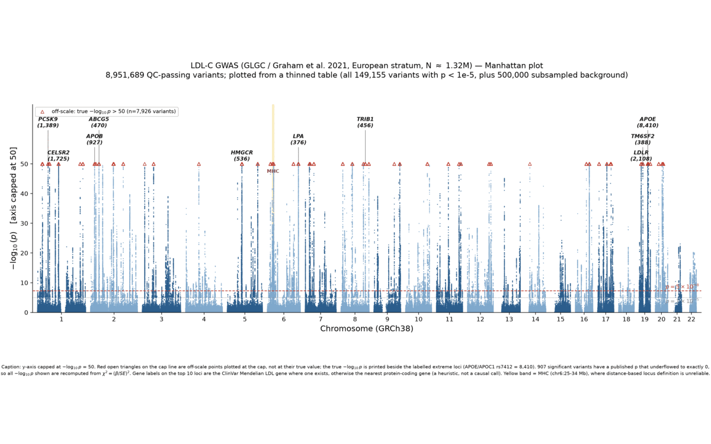

<p align="center">
  
</p>

<h3 align="center">Ask a biological question. Get the code, the figures, and a signed record of each step.</h3>

<p align="center">
  A chat window gives you an answer. Inflexa gives you the analysis.<br />
  An open-source AI agent for omics data. It runs on your machine.<br />
  Use your Claude, OpenAI, or Gemini account, or a local model.
</p>

<p align="center">
  <a href="#quick-start"><b>Quick start</b></a> ·
  <a href="#real-analyses-on-public-data"><b>Examples</b></a> ·
  <a href="#what-you-can-analyze"><b>What you can analyze</b></a> ·
  <a href="#cite-inflexa"><b>Cite</b></a>
</p>

<p align="center">
  <a href="https://github.com/inflexa-ai/inflexa/actions/workflows/test.yml"></a>
  <a href="https://scorecard.dev/viewer/?uri=github.com/inflexa-ai/inflexa"></a>
  <a href="./LICENSE"></a>
  <a href="https://doi.org/10.5281/zenodo.21361439"></a>
</p>

<p align="center">
  
</p>

<p align="center">
  <b>Install:</b> <code>brew install inflexa-ai/tap/inflexa</code> · <a href="#quick-start">other options</a>
</p>

## From question to result

The demo above uses GSE4115, a public study of airway cells from smokers with and without lung cancer.

**1. Ask about the data.** Inflexa reads the files and describes the study: the platform, the samples, the covariates, and the case and control split.

**2. Read the plan before the analysis runs.** For the demo, Inflexa wrote this plan (an excerpt):

> - **T1S2** — Covariate-adjusted limma DE (cancer vs no-cancer, adjusting for age/gender/race/smoking/packyears on the 163 complete samples), with an unadjusted 192-sample contrast as sensitivity check.
> - **T1S3** — GO BP/CC/MF over-representation of the DE genes.
> - **T2S1** — Leak-free cross-validated classifier (feature selection inside folds only), reporting AUC/sensitivity/specificity + signature stability.

Ask for changes. Inflexa asks for your approval before it runs the plan.

**3. Get files, not only an answer.** Each step writes its scripts, its data, and any figures to your analysis folder. If a step cannot do the work, it stops with a blocker and a reason. Ask for a report, and Inflexa writes one that opens from your disk.

<p align="center">
  <a href="https://inflexa.ai/tutorials/dexamethasone-airway-de-pathway"></a><br />
  <sub>A section of the GSE52778 tutorial report. <a href="https://doi.org/10.5281/zenodo.22081987">Get the full run on Zenodo</a>.</sub>
</p>

**4. Trace each result.** A signed provenance record connects each file to the inputs and the commands that made it:

```bash
inflexa prov lineage <analysis> <file>   # the inputs and the commands that made the file
inflexa prov verify <analysis>           # make sure that the hash chain and the signature are correct
inflexa prov export <analysis>           # export the record as W3C PROV
```

## Real analyses on public data

Each tutorial gives the dataset, the prompts as they were typed, the decisions, and the full report. Some runs also show where the analysis went wrong, and how Inflexa found it.

<table>
<tr>
<td width="50%" valign="top">

<a href="https://inflexa.ai/tutorials/dexamethasone-airway-de-pathway"></a>

**[What is dexamethasone doing to airway smooth muscle?](https://inflexa.ai/tutorials/dexamethasone-airway-de-pathway)**<br />
Bulk RNA-seq · GSE52778. Paired DE on an FPKM matrix, and a claim that the run withdrew after a check.

</td>
<td width="50%" valign="top">

<a href="https://inflexa.ai/tutorials/ifn-beta-pbmc-pseudobulk"></a>

**[What is IFN-β doing to PBMCs, cell type by cell type?](https://inflexa.ai/tutorials/ifn-beta-pbmc-pseudobulk)**<br />
Single-cell RNA-seq · GSE96583. 24,562 cells in 108 donor-paired pseudobulk libraries.

</td>
</tr>
<tr>
<td width="50%" valign="top">

<a href="https://inflexa.ai/tutorials/melanoma-immunotherapy-proteomics"></a>

**[Which proteins mark response to melanoma immunotherapy?](https://inflexa.ai/tutorials/melanoma-immunotherapy-proteomics)**<br />
Proteomics · PXD006003. A sign error that the run found in its own output.

</td>
<td width="50%" valign="top">

<a href="https://inflexa.ai/tutorials/ldl-gwas-to-drug-targets"></a>

**[Which way would a drug have to push each LDL gene?](https://inflexa.ai/tutorials/ldl-gwas-to-drug-targets)**<br />
GWAS · GCST90239658, N = 1.32M. With the known loss or gain of function, all nine established LDL genes get the correct drug direction.

</td>
</tr>
</table>

More: [all tutorials](https://inflexa.ai/tutorials), [live reports](https://inflexa.ai/examples), and a [case study](https://inflexa.ai/news/protect-pediatric-uc-responder-analysis) on 206 pediatric ulcerative colitis patients.

> ⭐ **Like what you see?** [Star the repository](https://github.com/inflexa-ai/inflexa). A star helps other scientists find Inflexa.

## Quick start

**1. Install.** You must have Docker or Podman, with Compose.

```bash
brew install inflexa-ai/tap/inflexa
```

<details>
<summary>Other install options: script, Windows, npm, binary</summary>

macOS or Linux, without Homebrew. The script makes sure that the checksum is correct, then installs to `~/.local/bin`:

```bash
curl -fsSL https://inflexa.ai/install.sh | bash
```

Windows (PowerShell):

```powershell
irm https://inflexa.ai/install.ps1 | iex
```

npm (Node.js 18 or later). You can also run `npx @inflexa-ai/inflexa` with no install:

```bash
npm install -g @inflexa-ai/inflexa
```

To install by hand, download a binary from the [latest release](https://github.com/inflexa-ai/inflexa/releases/latest).

</details>

**2. Set up.** Connect a model and get the sandbox. You do this one time. The sandbox images and the package store use approximately 20 GB of disk.

```bash
inflexa setup
```

**3. Try it on public data.** Make a folder and start an analysis:

```bash
mkdir lung-cancer && cd lung-cancer
inflexa new lung-cancer
```

Type these requests in the chat, one at a time:

```text
Download the GEO series GSE4115 and add it as an input.
What is this dataset about?
Plan a differential expression analysis of cancer versus no cancer.
Run the plan.
```

Inflexa asks before it downloads. To see the scripts, the data, and the figures, run `inflexa open lung-cancer`.

For your own data, go to the data folder and run `inflexa`. The full guide is at [inflexa.ai/docs](https://inflexa.ai/docs).

## Why Inflexa

- **You control what leaves your machine.** An Inflexa account is not necessary. Your model provider receives only the chat and the content that the agent reads. The research tools send queries, for example gene names, to public services such as PubMed. With a local model and local embeddings, the chat and your files stay on your machine.
- **The analysis code runs in a sandbox.** No network, no root, and a limit on CPU and memory. [`SECURITY.md`](./SECURITY.md) gives the full isolation model.
- **Use the model that you prefer.** Use a local model or your own endpoint. Or sign in with a Claude, OpenAI, Gemini, Qwen, or iFlow account.
- **Open source, in full.** Apache-2.0. The CLI is the complete product, not a trial.

## What you can analyze

Method guides in [`skills/`](./skills) tell the agent which method fits your data and your question. Each guide is open: read it, or improve it with a pull request.

<table>
<tr>
<td valign="top">

**Transcriptomics**<br />
Bulk RNA-seq · microarrays · DESeq2 · limma · edgeR

**Single-cell and spatial**<br />
scanpy · Seurat · CITE-seq · Multiome · Visium · MERFISH · squidpy

**Proteomics and metabolomics**<br />
DIA · TMT · Olink · SomaScan · untargeted and targeted metabolomics

**Genomics and epigenomics**<br />
VCF · PLINK · GWAS · methylation arrays · ATAC-seq and ChIP-seq peaks

</td>
<td valign="top">

**Microbiome and immunology**<br />
16S · ITS · shotgun metagenomics · immune deconvolution · TCR and BCR repertoires

**Pathways and networks**<br />
GSEA · ORA · TF activity with decoupler · WGCNA · multi-omics integration

**Statistics and machine learning**<br />
Survival analysis · classifiers · biomarker discovery

**Drug discovery**<br />
RDKit · drug repurposing · PK/PD · safety pharmacology

</td>
</tr>
</table>

Is a package not there? `inflexa store add <package>` adds one from PyPI, CRAN, or Bioconductor, with no image rebuild.

## Build from source

To build from source, you must have [Bun](https://bun.sh/). Refer to [`cli/README.md`](./cli/README.md) and [`CONTRIBUTING.md`](./CONTRIBUTING.md). [`CONTEXT.md`](./CONTEXT.md) gives the map of the repository.

## Cite Inflexa

If you use Inflexa in your research, cite it. GitHub shows a "Cite this repository" button from [`CITATION.cff`](./CITATION.cff). The DOI is [10.5281/zenodo.21361439](https://doi.org/10.5281/zenodo.21361439).

## Open source and commercial

Inflexa, Inc. develops Inflexa. The CLI in this repository is a complete product under [Apache-2.0](./LICENSE). A separate hosted platform adds team features, for example collaboration, governance, and managed infrastructure. [`COMMERCIAL.md`](./COMMERCIAL.md) gives the boundary and the commitments.

## Contribute

We welcome code, example datasets, documents, validation reports, and triage. Start with [`CONTRIBUTING.md`](./CONTRIBUTING.md). The project obeys a [Code of Conduct](./CODE_OF_CONDUCT.md) and the governance model in [`GOVERNANCE.md`](./GOVERNANCE.md).

## Security

Do not report a vulnerability in a public issue. Use the private process in [`SECURITY.md`](./SECURITY.md).

## License and trademarks

The code is under [Apache-2.0](./LICENSE). The Inflexa name and logo are trademarks, and [`TRADEMARK.md`](./TRADEMARK.md) gives the rules. You can use and fork the code, but give a redistributed fork a different name.
